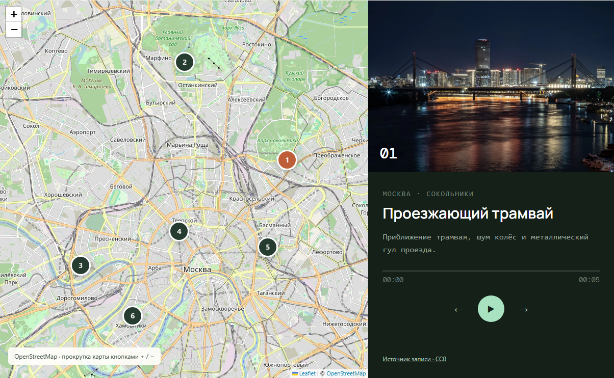

# EchoMap - атлас городских звуков

Каталог звуковых зарисовок с картой, выбором настроения, проигрывателем и заметками.

[Открыть проект](https://memorim.github.io/echomap-sound-atlas/)


## Возможности

- Фильтры каталога, сведения о месте и сохранение заметок.
- Воспроизведение настоящих полевых записей из локальных MP3.
- Фотографии города и обложки по настроению записи.

## Стек и устройство

JavaScript, Express, Zod, встроенный SQLite в Node.js, HTMLAudioElement, Leaflet и HTML/CSS.

## Ключевые решения

- SQL использует связанные параметры. Интерфейс и каталог работают как небольшое однопроцессное приложение.
- Ошибки JSON имеют ограниченный ответ; сервер по умолчанию слушает loopback.
- Плеер использует один `HTMLAudioElement`, проверяет результат `play()` и отменяет устаревший запуск при смене записи. Прогресс берётся из реального времени файла; остановка, скрытие вкладки и выход освобождают ресурс.
- Смена записи не пересоздаёт элементы списка и сохраняет клавиатурный фокус. Для всех настроений используются существующие фотографии; пустой каталог отключает управление.

## Локальный запуск

Node.js 24.18.0 и pnpm 11.7.0; версии закреплены в файлах проекта.

```bash
npm install --global pnpm@11.7.0
pnpm install --frozen-lockfile
pnpm start
```

Откройте `http://localhost:4700`. Сервер по умолчанию слушает 127.0.0.1. Для разработки доступен `pnpm dev`.

## Настройки

Параметры перечислены в [.env.example](.env.example). `pnpm start` использует окружение процесса и не загружает файл автоматически. После копирования `.env` его можно загрузить явно: `node --env-file=.env server.js`.

## Данные и обновления

SQLite хранится в `data/echomap.db`. Инициализация создаёт или обновляет схему. Перед обновлением сохраните резервную копию; удалять БД вместо миграции не нужно.

## Проверки

```bash
pnpm test
pnpm test:contract
pnpm test:upgrade
pnpm audit --audit-level=high
pnpm exec playwright install --with-deps --only-shell chromium
pnpm test:e2e
```

Проверяются каталог, заметки, внешние ключи SQLite, нулевые показатели пустого архива, контракт и обновление БД. Браузерные сценарии проверяют реальные аудиофайлы, повторное использование плеера, ошибку загрузки, отмену отложенного запуска, клавиатуру, обложки и маркеры карты.

Браузерные проверки запускают отдельную SQLite в памяти и не используют обычную папку `data`.

CI устанавливает зависимости по зафиксированным версиям и запускает настроенные проверки. Отдельная проверка документации находит неверные локальные ссылки и изображения. Проверка уязвимостей учитывает известные проблемы на момент запуска.

## Ограничения

- Аудиофайлы входят в приложение; загрузка пользовательских записей и отдельное потоковое хранилище не реализованы.
- Кнопка останавливает запись; новое воспроизведение начинается с нуля. Перемотки и сохранения пользовательской громкости нет. Физические устройства и особенности аудиотракта Safari требуют отдельной ручной проверки; проверки Chromium не измеряют качество слышимого звука.
- Заметки доступны через API; редактора заметок в интерфейсе нет. Внешний ключ проверяется на Node.js 24, но публичных аккаунтов, модерации и защиты массового приёма заметок нет. Внешняя публикация API требует отдельного контроля доступа.

## Документация

[Результаты аудита](docs/AUDIT_2026_10.md) · [Техническая документация](docs/TECHNICAL.md) · [Пример запроса и ответа](docs/API_EXAMPLE.md) · [История изменений](CHANGELOG.md)

## Версия в браузере

Открывается без установки. Изменения изолированы в памяти текущей вкладки и сбрасываются при перезагрузке. Серверные гарантии и SQLite относятся к локальному запуску, описанному выше.

Сборка: `python scripts/build_demo.py`. Проверка адаптера: `node --test demo/demo.test.mjs`.

### Аудиозаписи и карта

В плеере используются восемь настоящих записей из Freesound с лицензией CC0. Звук не синтезируется. Файлы находятся в `public/audio/`; происхождение, контрольные суммы и фактическая длительность перечислены в [sources.json](public/audio/sources.json). Каталог API и статическая версия используют одинаковые метаданные `recordings.json`. Сохранённые заметки и база данных не перезаписываются.

Карта построена на Leaflet и тайлах OpenStreetMap. Точки - звуковые маршруты; они не являются утверждением, что исходный файл был записан именно в отмеченной точке. Ссылка на оригинал каждой записи есть в плеере. Карта требует сети; аудио хранится вместе с приложением. Подложка загружается только для видимой области, без предварительного скачивания тайлов.

Проверка плеера и выбора точек: `pnpm test:e2e`. Метаданные и файлы аудио: `pnpm test`.


