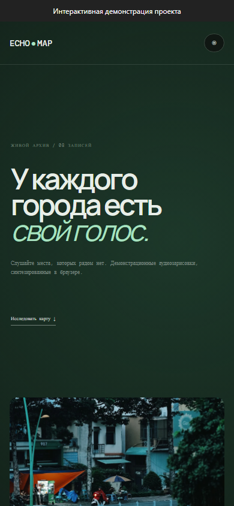

# EchoMap — атлас городских звуков

Каталог звуковых зарисовок с картой, выбором настроения, проигрывателем и заметками.




[Короткая демонстрация](docs/demo.gif)

## Возможности

- Фильтры каталога, сведения о месте и сохранение заметок.
- Воспроизведение звуковых текстур через Web Audio.
- Фотографии города и обложки по настроению записи.

## Стек и устройство

JavaScript, Express, Zod, встроенный SQLite в Node.js, Web Audio и HTML/CSS.

## Ключевые решения

- SQL использует связанные параметры. Интерфейс и каталог работают как небольшое однопроцессное приложение.
- Ошибки JSON имеют ограниченный ответ; сервер по умолчанию слушает loopback.

## Локальный запуск

Node.js 24.18.0 и pnpm 11.7.0; версии закреплены в файлах проекта.

```bash
npm install --global pnpm@11.7.0
pnpm install --frozen-lockfile
pnpm start
```

Откройте `http://localhost:4700`. Сервер по умолчанию слушает 127.0.0.1. Для разработки доступен `pnpm dev`.

## Настройки

Параметры перечислены в [.env.example](.env.example). `pnpm start` использует окружение процесса и не загружает файл автоматически. После копирования `.env` его можно загрузить явно: `node --env-file=.env server.js`.

## Данные и обновления

SQLite хранится в `data/echomap.db`. Инициализация создаёт или обновляет схему. Перед обновлением сохраните резервную копию; удалять БД вместо миграции не нужно.

## Проверки

```bash
pnpm test
pnpm test:contract
pnpm test:upgrade
pnpm audit --audit-level=high
```

Проверки каталога и заметок, некорректного JSON, контракта ответов и обновления схемы БД.

CI устанавливает зависимости по зафиксированным версиям и запускает настроенные проверки. Отдельная проверка документации находит неверные локальные ссылки и изображения. Проверка уязвимостей учитывает известные проблемы на момент запуска.

## Ограничения

- Звук синтезируется в браузере: загрузка и потоковая передача полевых записей не реализованы.
- Нет публичных аккаунтов и модерации. Внешние ключи и конкурентная модерация требуют дополнительной проверки перед массовым приёмом недоверенных заметок.

## Документация

[Результаты аудита](docs/AUDIT_2026_10.md) · [Техническая документация](docs/TECHNICAL.md) · [Пример запроса и ответа](docs/API_EXAMPLE.md) · [История изменений](CHANGELOG.md)
