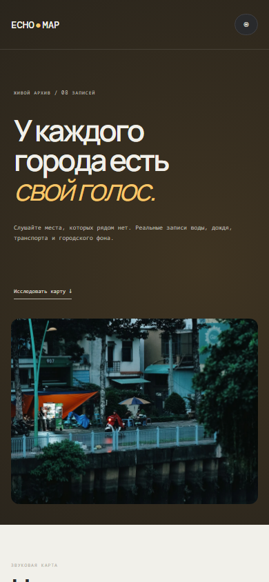
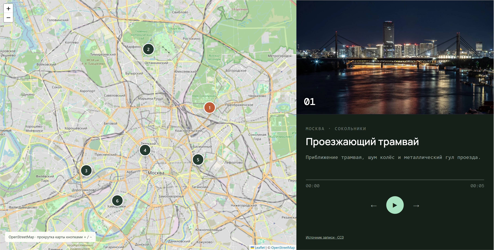

# EchoMap - атлас городских звуков

Каталог звуковых зарисовок с картой, выбором настроения, проигрывателем и заметками.

[Открыть проект](https://memorim.github.io/echomap-sound-atlas/)




## Возможности

- Фильтры каталога, сведения о месте и сохранение заметок.
- Воспроизведение настоящих полевых записей из локальных MP3.
- Фотографии города и обложки по настроению записи.

## Стек и устройство

JavaScript, Express, Zod, встроенный SQLite в Node.js, HTMLAudioElement, Leaflet и HTML/CSS.

## Ключевые решения

- SQL использует связанные параметры. Интерфейс и каталог работают как небольшое однопроцессное приложение.
- Ошибки JSON имеют ограниченный ответ; сервер по умолчанию слушает loopback.
- Плеер использует один `HTMLAudioElement`, проверяет результат `play()` и отменяет устаревший запуск при смене записи. Прогресс берётся из реального времени файла; остановка, скрытие вкладки и выход освобождают ресурс.
- Смена записи не пересоздаёт элементы списка и сохраняет клавиатурный фокус. Для всех настроений используются существующие фотографии; пустой каталог отключает управление.

## Локальный запуск

Node.js 24.18.0 и pnpm 11.7.0; версии закреплены в файлах проекта.

```bash
npm install --global pnpm@11.7.0
pnpm install --frozen-lockfile
pnpm start
```

Откройте `http://localhost:4700`. Сервер по умолчанию слушает 127.0.0.1. Для разработки доступен `pnpm dev`.

## Настройки

Параметры перечислены в [.env.example](.env.example). `pnpm start` использует окружение процесса и не загружает файл автоматически. После копирования `.env` его можно загрузить явно: `node --env-file=.env server.js`.

## Данные и обновления

SQLite хранится в `data/echomap.db`. Инициализация создаёт или обновляет схему. Перед обновлением сохраните резервную копию; удалять БД вместо миграции не нужно.

## Проверки

```bash
pnpm test
pnpm test:contract
pnpm test:upgrade
pnpm audit --audit-level=high
pnpm exec playwright install --with-deps --only-shell chromium
pnpm test:e2e
```

Проверяются каталог, заметки, внешние ключи SQLite, нулевые показатели пустого архива, контракт и обновление БД. Браузерные сценарии проверяют реальные аудиофайлы, повторное использование плеера, ошибку загрузки, отмену отложенного запуска, клавиатуру, обложки и маркеры карты.

Браузерные проверки запускают отдельную SQLite в памяти и не используют обычную папку `data`.

CI устанавливает зависимости по зафиксированным версиям и запускает настроенные проверки. Отдельная проверка документации находит неверные локальные ссылки и изображения. Проверка уязвимостей учитывает известные проблемы на момент запуска.

## Ограничения

- Исходные записи входят в приложение. Пользовательская загрузка поддерживает PCM WAV до 20 МБ и 600 секунд; файлы хранятся в data/uploads вне публичного каталога. Для внешнего размещения нужен постоянный диск и резервные копии.
- Ползунок времени позволяет перемотать загруженную запись, громкость запоминается в браузере. Кнопка остановки начинает следующий сеанс воспроизведения с нуля.

Обложки двух записей используют отдельные фотографии. «Шаги в тоннеле» — [Retired electrician, CC0](https://commons.wikimedia.org/wiki/File:Moscow,_Shelepikhinsky_Bridge_stairs_and_tunnels,_May_2025_01.jpg). «Двор после школы» — [NVO, школьный двор в Верее](https://commons.wikimedia.org/wiki/File:Vereya_school_yard_01.JPG). Обе фотографии уменьшены и сохранены в WebP. Производная фотография двора распространяется под [CC BY-SA 3.0](https://creativecommons.org/licenses/by-sa/3.0/).
- В публичном режиме заметки требуют ключ автора из APP_UPLOADERS и публикуются после одобрения владельцем в /owner.html. Имя автора определяется сервером; бюджет 10 попыток в минуту сохраняется в SQLite и разделяется процессами. Локальный режим оставляет мгновенную публикацию для доверенного оператора. Для нескольких серверов нужна общая БД или общая служба лимитов.

## Документация

[Результаты аудита](docs/AUDIT_2026_10.md) · [Техническая документация](docs/TECHNICAL.md) · [Пример запроса и ответа](docs/API_EXAMPLE.md) · [История изменений](CHANGELOG.md)

## Версия в браузере

Открывается без установки. Изменения изолированы в памяти текущей вкладки и сбрасываются при перезагрузке. Серверные гарантии и SQLite относятся к локальному запуску, описанному выше.

Сборка: `python scripts/build_demo.py`. Проверка адаптера: `node --test demo/demo.test.mjs`.

### Аудиозаписи и карта

В плеере используются восемь настоящих записей из Freesound с лицензией CC0. Звук не синтезируется. Файлы находятся в `public/audio/`; происхождение, контрольные суммы и фактическая длительность перечислены в [sources.json](public/audio/sources.json). Каталог API и статическая версия используют одинаковые метаданные `recordings.json`. Сохранённые заметки и база данных не перезаписываются.

Карта построена на Leaflet и тайлах OpenStreetMap. Точки - звуковые маршруты; они не являются утверждением, что исходный файл был записан именно в отмеченной точке. Ссылка на оригинал каждой записи есть в плеере. Карта требует сети; аудио хранится вместе с приложением. Подложка загружается только для видимой области, без предварительного скачивания тайлов.

Проверка плеера и выбора точек: `pnpm test:e2e`. Метаданные и файлы аудио: `pnpm test`.



### Полевые заметки

Под картой доступны заметки выбранной записи и форма добавления. Черновики сохраняются при переключении записей в пределах вкладки; при ошибке отправки текст остаётся в форме. Заметки пользователей выводятся как текст.

### Загрузка и модерация

APP_UPLOADERS — JSON-объект, где ключ — SHA-256 случайного секрета автора (от 32 символов), значение — идентификатор автора. APP_OWNER_TOKEN — отдельный секрет модератора. POST /api/uploads принимает audio/wav и метаданные title/city/lat/lng/license=CC0-1.0; принадлежность автору задаёт сервер, не запрос. Автор подтверждает лицензию в форме. GET /api/uploads/mine показывает только собственные загрузки.

GET /api/owner/uploads и PATCH /api/owner/uploads/:id требуют Bearer-токен модератора; решения approved/rejected. До одобрения файл и карточка недоступны публично. Квоты: до 100 файлов и 100 МБ на автора, 1 ГБ суммарно. Плеер получает WAV через защищённую проверкой статуса выдачу с поддержкой Range. Для публичного API задайте APP_PUBLIC_ORIGIN и TLS-прокси.


### Кабинет владельца

При серверном запуске откройте `/owner.html`: модерация записей. Вход по `APP_OWNER_TOKEN`; ключ не сохраняется в localStorage или URL и удаляется при выходе. На GitHub Pages кабинет не подключён к серверной базе.

### Постоянный диск и полная резервная копия

`ECHOMAP_DATA_DIRECTORY` задаёт общий путь для SQLite и пользовательских WAV. [Инструкция по архивированию и восстановлению](docs/PERSISTENT_STORAGE.md) описывает перенос данных и команды `node scripts/archive.mjs backup|restore SOURCE NEW_DESTINATION`. Архив включает заметки, модерацию и все связанные WAV; восстановление проверяет контрольные суммы и создаёт новый каталог.

## Размещение и снимки — 08.11.2026

Сборка бесплатного Render web-сервиса прошла, но запуск остановился на `EACCES` для `/var/data/echomap`: SQLite и WAV требуют постоянного диска. Этот сервис не считаю размещённым; нужны бесплатный внешний узел, расписание архивов и off-site копии.

Визуальный интерфейс не менялся; desktop/mobile снимки выше остаются актуальными и должны обновляться при следующем изменении UI.


## Бесплатная проверка и хранение

GitHub Actions теперь каждый час или вручную проверяет опубликованный Render URL. Это бесплатная замена простому расписанию проверки доступности. Постоянное хранение пользовательских аудиофайлов и копии вне сервера всё ещё требуют внешнего бесплатного storage; бесплатный Render сам по себе постоянный диск не предоставляет.
